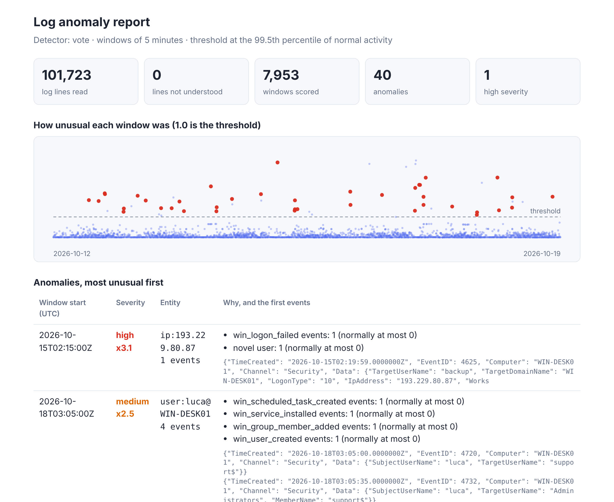

# loganomaly: anomaly detection on auth, web and Windows logs

[](https://github.com/TexAlphaWolf/sec-log-anomaly-ml/actions/workflows/ci.yml)
[](https://github.com/TexAlphaWolf/sec-log-anomaly-ml/actions/workflows/codeql.yml)


Learns what *normal* looks like in your logs and flags what is not, without labelled attacks:
brute force, password spraying, account takeover, web scanning and floods, RDP attacks, persistence
on Windows. It reads Linux `auth.log` / journald, nginx/Apache access logs and exported Windows
Security events, runs four detectors side by side, and tells you **why** each window was flagged.



## Goal

Rules catch what you thought of. This project shows the other half of the job: building,
evaluating and *honestly comparing* unsupervised detectors (a robust z-score, Isolation Forest,
an autoencoder and a DeepLog-style next-event network) on labelled data, and turning the winner
into a tool a person can run and understand. Everything is written in NumPy, tested, and
measured, including where it fails ([limitations](docs/limitations.md)).

## Quick start

No data needed: the demo generates two weeks of labelled logs with twelve kinds of attack, trains
on the first week, scores the second, prints the comparison and writes the report.

```bash
docker build -t loganomaly .
docker run --rm -v "$PWD/out:/work" loganomaly demo --out /work/demo
# open out/demo/report.html
```

or without Docker:

```bash
pip install .
loganomaly demo --out demo        # about 15 seconds
```

On Windows, `pip install` often puts `loganomaly.exe` in a folder that is not on `PATH`. Use
`python -m loganomaly demo --out demo` instead; every command below works that way too.

### On your own logs

```bash
loganomaly train  --auth /var/log/auth.log --web /var/log/nginx/access.log --year 2026 --out model
loganomaly detect --auth auth.log.1 --web access.log.1 --year 2026 --model model --report report.html
```

Windows: run `tools\export-windows-events.ps1` in an elevated PowerShell, then pass the file
with `--windows`. Details, time zones and what is understood: [log sources](docs/log-sources.md).

## What the comparison shows

Mean over 5 synthetic datasets (14 days, 7 for training, ~100,000 log lines each, 92 attack
windows in the test week), thresholds at the 99.5th percentile of training scores. Full tables,
per-attack recall and cost: [docs/results.md](docs/results.md).

| Detector | ROC AUC | Precision | Recall | False alerts/day | Campaigns found |
|---|---|---|---|---|---|
| z-score baseline | 0.994 | 0.71 | 0.70 | 3.7 | 71 % |
| Isolation Forest | 0.988 | 0.51 | 0.41 | 5.0 | 55 % |
| Autoencoder | **0.995** | 0.63 | **0.87** | 6.8 | **92 %** |
| Next-event network | 0.938 | 0.47 | 0.31 | 4.6 | 36 % |
| Vote (2 of 3) | 0.992 | **0.77** | 0.58 | **2.3** | 70 % |

What I take from it:

- **The autoencoder finds the most attacks**, at the price of the most false alerts. The vote
  trades recall for precision: choose by what a false alert costs you.
- **A one-line z-score is a strong baseline.** On single-feature attacks (floods of failures) it
  matches the neural models, and with attacks already in the training period it beats them. It
  misses attacks that are only unusual in combination (`web_probe`, `web_flood`).
- **Isolation Forest is weak on sparse counts**, and the sequence model is blind to volume: a
  flood of normal-looking requests is not surprising. Each is the right tool for something else.
- **Dirty training hurts everyone** (section 2 of the results): attacks present while learning
  become "normal".
- **Low-and-slow attacks are the open problem**: no detector reliably sees one attempt an hour.

These are synthetic logs: they rank the methods against each other, they do not predict your
false-alert rate. Run it on your own logs for that.

## How it works

`events → windows (entity × 5 min) → 46 features → four detectors → thresholds → vote → reasons`.
Each alert comes with the features that left the range 99 % of normal windows stay inside
("`win_logon_failed` events: 1, normally at most 0"), or the surprising transition for the sequence
model. See [architecture](docs/architecture.md), [features](docs/features.md) and
[models](docs/models.md).

## Quality and security

- 92 tests, 98 % coverage; the autoencoder's gradients are checked against finite differences and
  the Isolation Forest against scikit-learn's.
- CI on Python 3.11 to 3.14: ruff, mypy, pytest, a **model quality gate** (the build fails if the
  detectors get clearly worse), the Docker image and the demo inside it, CodeQL, `pip-audit`.
- No pickle: models are JSON plus a NumPy archive loaded with `allow_pickle=False` and checked
  against a SHA-256; the HTML report escapes all log text and has a strict CSP. See
  [SECURITY.md](SECURITY.md).

## Where it runs

Any machine with Python 3.11+ (or Docker). One dependency (NumPy); training takes seconds on a
laptop, so it fits a Raspberry Pi or the home server this portfolio grows into.

## Roadmap

- [x] **M1 - MVP**: parsers, features, four detectors, evaluation on labelled synthetic logs
- [x] **M2 - Packaging**: Docker image, CLI, HTML report, documentation with measured results
- [x] **M3 - Quality**: tests, CI, quality gate, CodeQL, release 1.0
- [ ] Later: aggregate by target to see distributed attacks, streaming input, day-of-week features

## Data notice

All data in this repository is synthetic. Do not commit your own logs or models: they contain
addresses and account names.

## License

MIT - Luca Tessitore
