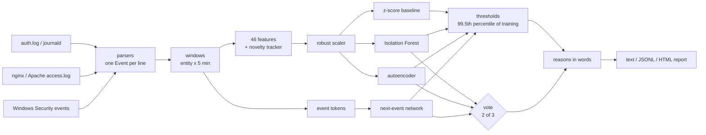

# Architecture

## From a log line to an alert

1. **Parse.** Each line becomes an `Event` (`events.py`): timestamp, source, a `kind` from a fixed
   vocabulary of 27 (`ssh_failed_password`, `web_notfound`, `win_logon_failed`, ...), host, address,
   account, and for web lines the path, method and User-Agent. Lines that are not understood are
   counted and skipped; they never stop a run.
2. **Window.** Events are grouped by *entity* (the source address, or the account when there is
   none) and by five-minute slice. An attacker therefore gets their own row instead of being
   averaged into the whole server's traffic.
3. **Featurise.** Every window becomes 46 numbers ([features](features.md)). A `Tracker` remembers
   which addresses, accounts and (account, address) pairs have been seen, so "first time" is a
   feature. It only learns from windows that are already in the past, so a window never explains
   itself away.
4. **Scale.** Median / MAD scaling per column. Most columns are zero almost everywhere; when MAD is
   zero the standard deviation is used, then 1, so a value never seen in training gets a large
   score instead of a division by zero.
5. **Score.** Four detectors ([models](models.md)). Each learns what the training days look like
   and scores a window by how badly it fits.
6. **Threshold.** The 99.5th percentile of each detector's *training* scores, so roughly one in
   two hundred normal windows would raise an alert. It is a setting (`--quantile`).
7. **Vote.** A window is flagged when at least two of the three learned detectors flag it.
8. **Explain.** For every flagged window the report lists which features were outside the range
   99% of normal windows stay inside ([how reasons are chosen](models.md#reasons)).

## Code map

| Module | Role |
| --- | --- |
| `events.py`, `parsers.py`, `sources.py` | Event vocabulary, the four parsers, reading files and stdin |
| `features.py` | Windows, the 46 features, the novelty tracker, tokens for the sequence model |
| `models/` | `zscore`, `iforest`, `autoencoder`, `sequence` and the small `nn` helpers (Adam, init) |
| `pipeline.py` | `train` and `analyse`, the vote |
| `store.py` | Saving and loading a model (JSON + `.npz`, checksum) |
| `explain.py`, `report.py` | Reasons, text/JSONL output, the HTML report |
| `synth.py`, `evaluate.py`, `benchmark.py` | Labelled synthetic logs, metrics, the multi-seed comparison |
| `cli.py` | The `loganomaly` command |

## Why NumPy only

The tool installs with one dependency and trains in seconds on a laptop or a Raspberry Pi. The
models are small enough to write out in full, which also makes them testable: the autoencoder's
gradients are checked against finite differences, and the Isolation Forest is checked against
scikit-learn's. A model file is a JSON file plus an array archive, loaded without pickle, so
opening someone else's model cannot run their code.
